# PureLedger Business Logic Audit Report

**Date:** 2024-12-19  
**Audited Components:**
- DeliveryChallanApiController
- HomeApiController
- JournalEntryService
- DeliveryChallanService
- SharedProcessingService

**Overall Grade: B+ (85/100)**

---

## Executive Summary

This audit examines the business logic implementation across five core components of the PureLedger system. The codebase demonstrates solid architectural patterns with clear separation of concerns, but several critical issues and potential improvements have been identified.

### Key Findings

✅ **Strengths:**
- Well-structured service layer with clear responsibilities
- Comprehensive transaction management
- Good use of shared services for common logic
- Proper handling of reference vouchers

⚠️ **Critical Issues:**
- Race condition risks in voucher completion
- Incomplete validation in some operations
- Potential data inconsistency in edge cases
- Missing error recovery mechanisms

---

## Table of Contents

1. [SharedProcessingService Analysis](#1-sharedprocessingservice-analysis)
2. [JournalEntryService Analysis](#2-journalentryservice-analysis)
3. [DeliveryChallanService Analysis](#3-deliverychallanservice-analysis)
4. [HomeApiController Analysis](#4-homeapicontroller-analysis)
5. [DeliveryChallanApiController Analysis](#5-deliverychallanapicontroller-analysis)
6. [Cross-Service Issues](#6-cross-service-issues)
7. [Recommendations](#7-recommendations)

---

## 1. SharedProcessingService Analysis

**Grade: A- (90/100)**

### 1.1 Business Logic Overview

The `SharedProcessingService` is the central orchestration service that manages:
- Entry processing state determination
- Voucher completion status
- Reference voucher lifecycle
- Delivery Challan entry linkage

### 1.2 Entry Processing State Logic

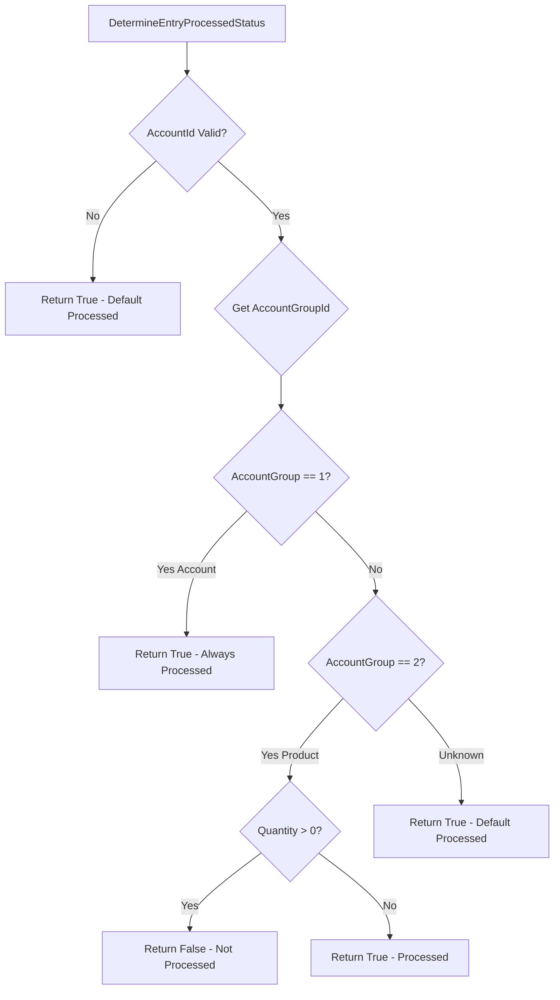

**Business Rules:**
1. **Account entries (Group 1):** Always processed (`IsProcessed = true`)
2. **Product entries (Group 2):** Processed only if `Quantity <= 0`
3. **Invalid accounts:** Default to processed (safe fallback)

**Issues Identified:**
- ⚠️ **Issue 1.1:** No validation that account exists before checking group
- ⚠️ **Issue 1.2:** Silent failure for unknown account groups (should log error)

### 1.3 Voucher Completion Logic

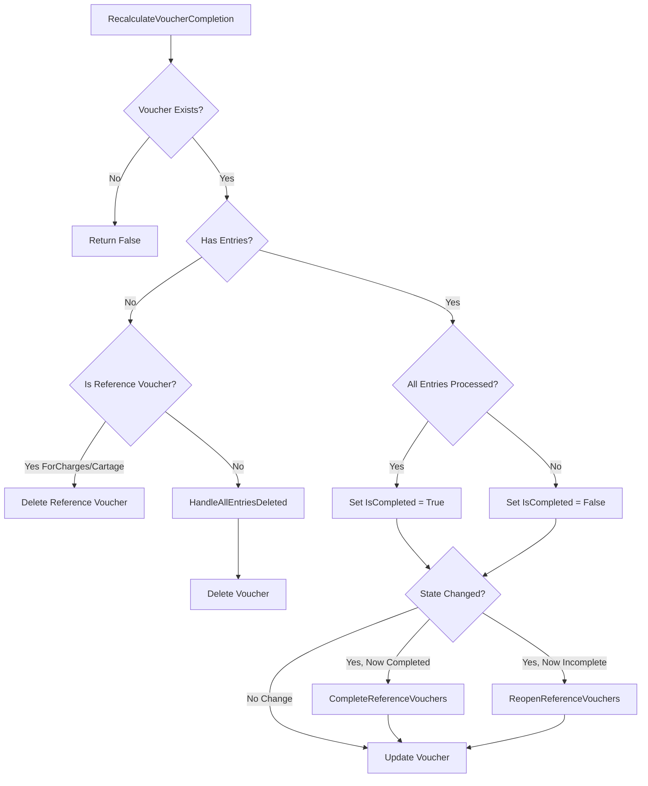

**Business Rules:**
1. Voucher is completed when **ALL** entries are processed
2. Empty vouchers trigger cleanup (DC, references)
3. State changes cascade to reference vouchers (ForCharges/Cartage only)
4. DerivedVoucher references are NOT affected by completion state

**Issues Identified:**
- ✅ **Good:** Proper handling of empty vouchers
- ✅ **Good:** Separation of DerivedVoucher from ForCharges/Cartage
- ⚠️ **Issue 1.3:** Race condition possible if multiple entries updated simultaneously
- ⚠️ **Issue 1.4:** No validation that voucher state transition is valid

### 1.4 Reference Voucher Management

**Reference Types:**
1. **ForCharges:** Created when processing FOR charges, deleted when main voucher deleted
2. **Cartage:** Created for cartage processing, deleted when main voucher deleted
3. **DerivedVoucher:** Created from base vouchers, preserved when main voucher deleted

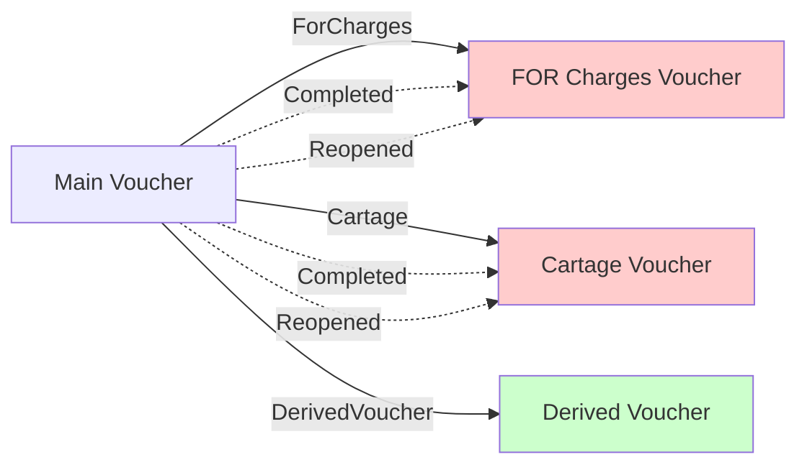

**Issues Identified:**
- ✅ **Good:** Proper type validation
- ✅ **Good:** Different cleanup strategies per type
- ⚠️ **Issue 1.5:** No check for circular references (should be impossible but not validated)

---

## 2. JournalEntryService Analysis

**Grade: B+ (85/100)**

### 2.1 Voucher Creation Flow

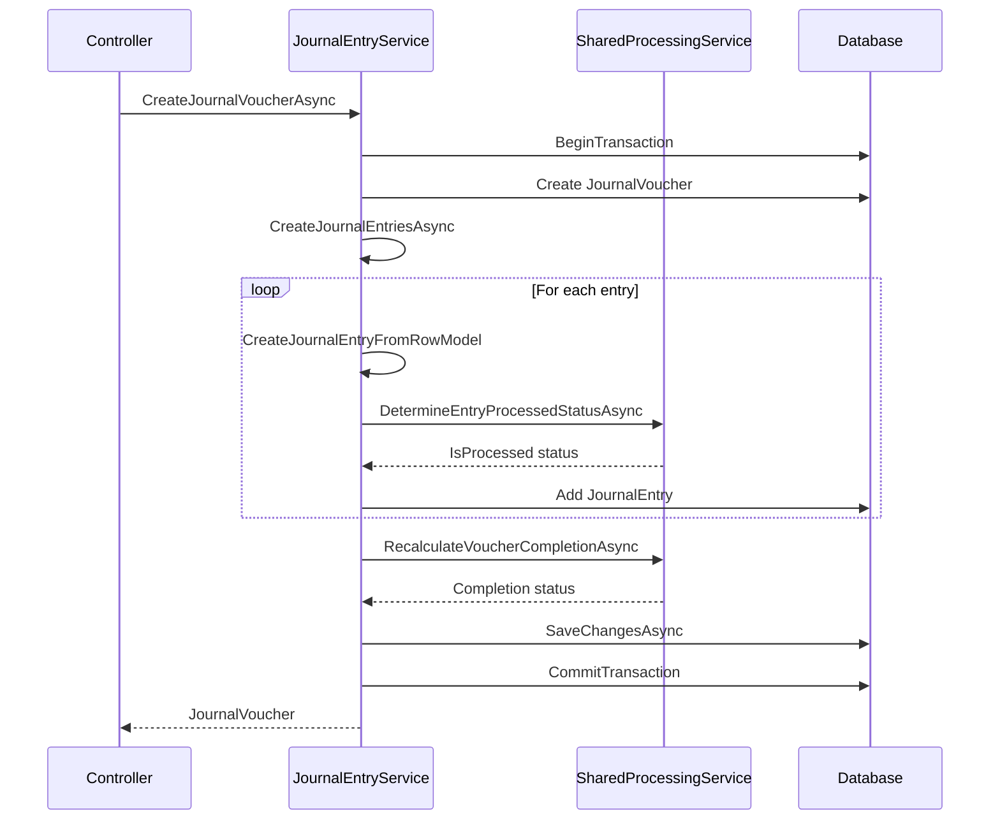

**Issues Identified:**
- ✅ **Good:** Proper transaction management
- ✅ **Good:** Single SaveChanges at end
- ⚠️ **Issue 2.1:** No validation that entries balance (Debit = Credit)
- ⚠️ **Issue 2.2:** No check for duplicate entries (same Account+Category+Description)

### 2.2 Entry Update Logic

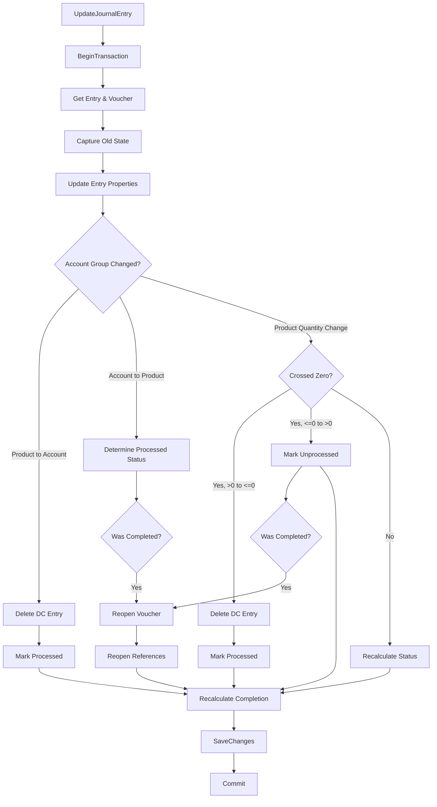

**Issues Identified:**
- ✅ **Good:** Comprehensive state transition handling
- ✅ **Good:** Proper DC entry cleanup
- ⚠️ **Issue 2.3:** Complex logic in HandleEntryUpdateAsync (high cyclomatic complexity)
- ⚠️ **Issue 2.4:** No validation that quantity change is valid (e.g., negative to positive)

### 2.3 Derived Voucher Creation

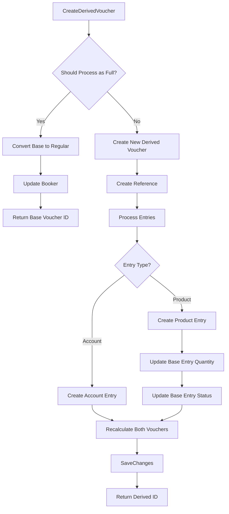

**Issues Identified:**
- ✅ **Good:** Smart conversion logic (full processing)
- ⚠️ **Issue 2.5:** No validation that base voucher has sufficient quantity
- ⚠️ **Issue 2.6:** No check for concurrent processing of same base voucher
- ⚠️ **Issue 2.7:** Quantity reduction could result in negative (not validated)

### 2.4 Entry Deletion Logic

**Flow:**
1. Delete linked DC entry (if exists)
2. Delete journal entry
3. Check if voucher is empty
4. Recalculate completion

**Issues Identified:**
- ✅ **Good:** Proper cleanup of DC entries
- ✅ **Good:** Handles empty voucher case
- ⚠️ **Issue 2.8:** No check if entry is referenced elsewhere (e.g., in derived voucher)

---

## 3. DeliveryChallanService Analysis

**Grade: B (80/100)**

### 3.1 Single Entry Processing

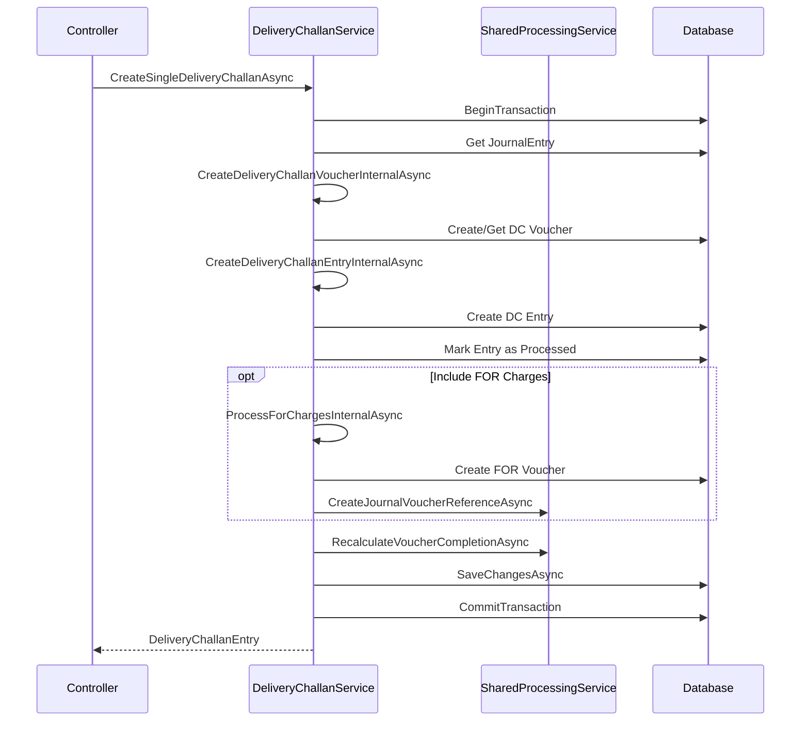

**Issues Identified:**
- ✅ **Good:** Transaction management
- ⚠️ **Issue 3.1:** No validation that entry is eligible for DC (quantity > 0, not processed)
- ⚠️ **Issue 3.2:** No check if DC already exists for this entry
- ⚠️ **Issue 3.3:** FOR charges amount not validated (could be 0 or negative)

### 3.2 Batch Processing

**Flow:**
1. Get unprocessed entries
2. Create DC voucher
3. Process each entry
4. Optionally process FOR charges
5. Recalculate completion

**Issues Identified:**
- ✅ **Good:** Handles partial failures gracefully
- ⚠️ **Issue 3.4:** No validation that all entries belong to same voucher
- ⚠️ **Issue 3.5:** No check for duplicate entries in batch

### 3.3 Cartage Processing

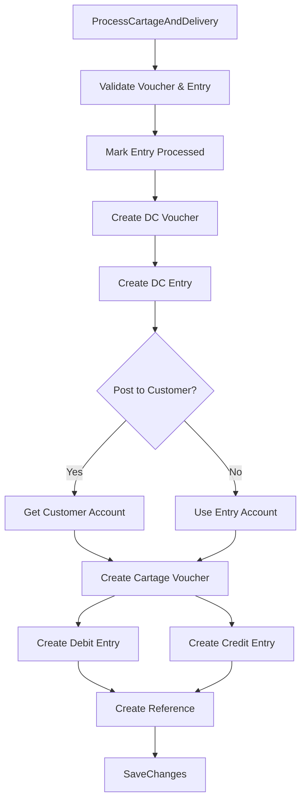

**Issues Identified:**
- ✅ **Good:** Proper account selection logic
- ⚠️ **Issue 3.6:** No validation that transporter account exists
- ⚠️ **Issue 3.7:** No check that cartage category is configured
- ⚠️ **Issue 3.8:** Amount not validated (could be 0 or negative)

### 3.4 FOR Charges Processing

**Flow:**
1. Get FOR account from project settings
2. Get customer account from voucher
3. Create FOR voucher
4. Create debit entry (FOR account)
5. Create credit entry (Customer account)
6. Update PendingForCharges = false
7. Mark FOR voucher as completed

**Issues Identified:**
- ✅ **Good:** Proper account resolution
- ⚠️ **Issue 3.9:** No validation that FOR account is configured
- ⚠️ **Issue 3.10:** No check that customer account exists in voucher
- ⚠️ **Issue 3.11:** Amount not validated

---

## 4. HomeApiController Analysis

**Grade: A- (90/100)**

### 4.1 Controller Responsibilities

The `HomeApiController` acts as the API gateway for:
- Journal entry management
- Voucher operations
- Base voucher processing
- Recipe management
- Lookup endpoints

**Issues Identified:**
- ✅ **Good:** Clear separation of concerns
- ✅ **Good:** Proper error handling
- ⚠️ **Issue 4.1:** Some endpoints return too much data (could be paginated)
- ⚠️ **Issue 4.2:** No rate limiting on lookup endpoints

### 4.2 Entry Creation/Update Flow

**Issues Identified:**
- ✅ **Good:** Proper use of service layer
- ✅ **Good:** Transaction management in service
- ⚠️ **Issue 4.3:** No validation that project belongs to user
- ⚠️ **Issue 4.4:** No check for voucher edit conflicts (RowVersion not used)

### 4.3 Base Voucher Processing

**Issues Identified:**
- ✅ **Good:** Proper pagination
- ⚠️ **Issue 4.5:** No validation that user has access to project
- ⚠️ **Issue 4.6:** No check if voucher is already being processed

---

## 5. DeliveryChallanApiController Analysis

**Grade: B+ (85/100)**

### 5.1 Controller Responsibilities

The `DeliveryChallanApiController` handles:
- DC data retrieval
- Entry filtering
- Single entry processing
- Batch processing
- Cartage processing
- FOR charges processing

**Issues Identified:**
- ✅ **Good:** Comprehensive endpoint coverage
- ⚠️ **Issue 5.1:** No validation that project belongs to user in some endpoints
- ⚠️ **Issue 5.2:** Filter validation could be stricter

### 5.2 Filtered Entries Endpoint

**Issues Identified:**
- ✅ **Good:** Proper filtering logic
- ⚠️ **Issue 5.3:** No pagination (could return large datasets)
- ⚠️ **Issue 5.4:** Hidden categories logic is complex (could be optimized)

---

## 6. Cross-Service Issues

### 6.1 Transaction Management

**Current State:**
- Services properly use transactions
- Single SaveChanges at end of transaction
- Proper rollback on errors

**Issues:**
- ⚠️ **Issue 6.1:** No distributed transaction support (if needed in future)
- ⚠️ **Issue 6.2:** Long-running transactions could cause locks

### 6.2 State Consistency

**Issues:**
- ⚠️ **Issue 6.3:** Race conditions possible when multiple entries updated simultaneously
- ⚠️ **Issue 6.4:** No optimistic concurrency for entries (only vouchers have RowVersion)
- ⚠️ **Issue 6.5:** Voucher completion could be calculated incorrectly if entries change during calculation

### 6.3 Error Handling

**Current State:**
- Good exception handling in services
- Proper logging
- Transaction rollback on errors

**Issues:**
- ⚠️ **Issue 6.6:** Some errors are swallowed (e.g., in batch processing)
- ⚠️ **Issue 6.7:** No retry logic for transient failures
- ⚠️ **Issue 6.8:** Error messages could be more user-friendly

### 6.4 Validation

**Issues:**
- ⚠️ **Issue 6.9:** Missing validation in many places:
  - Entry amounts (debit/credit balance)
  - Quantity changes (negative values)
  - Account existence
  - Category existence
  - Project access
- ⚠️ **Issue 6.10:** No business rule validation (e.g., can't process entry twice)

---

## 7. Recommendations

### 7.1 Critical Fixes (Priority 1)

1. **Add Entry Validation**
   ```csharp
   // Validate entry before processing
   if (entry.Quantity < 0)
       throw new ArgumentException("Quantity cannot be negative");
   
   if (entry.IsProcessed)
       throw new InvalidOperationException("Entry already processed");
   ```

2. **Add Optimistic Concurrency for Entries**
   ```csharp
   // Add RowVersion to JournalEntry model
   [Timestamp]
   public byte[]? RowVersion { get; set; }
   ```

3. **Validate Voucher Balance**
   ```csharp
   // In CreateJournalVoucherAsync
   var totalDebit = entries.Sum(e => e.Debit);
   var totalCredit = entries.Sum(e => e.Credit);
   if (Math.Abs(totalDebit - totalCredit) > 0.01m)
       throw new InvalidOperationException("Voucher entries must balance");
   ```

4. **Add Quantity Validation in Derived Voucher**
   ```csharp
   // In ProcessDerivedVoucherEntriesAsync
   if (entryToProcess.ProcessQuantity > baseEntry.Quantity)
       throw new ArgumentException("Process quantity exceeds available quantity");
   ```

### 7.2 Important Improvements (Priority 2)

1. **Add Retry Logic for Transient Failures**
2. **Implement Pagination for Large Datasets**
3. **Add Caching for Lookup Endpoints**
4. **Improve Error Messages**
5. **Add Business Rule Validation Layer**

### 7.3 Nice to Have (Priority 3)

1. **Add Audit Logging**
2. **Implement Event Sourcing for Critical Operations**
3. **Add Performance Monitoring**
4. **Create Unit Tests for Complex Logic**
5. **Add Integration Tests**

---

## 8. Detailed Issue List

### Critical Issues (Must Fix)

| ID | Component | Issue | Severity | Impact |
|----|-----------|-------|----------|--------|
| 2.5 | JournalEntryService | No quantity validation in derived voucher | High | Data corruption |
| 3.1 | DeliveryChallanService | No eligibility check before DC creation | High | Invalid data |
| 6.3 | Cross-Service | Race conditions in voucher completion | High | Incorrect state |
| 6.9 | Cross-Service | Missing validation throughout | High | Data integrity |

### Important Issues (Should Fix)

| ID | Component | Issue | Severity | Impact |
|----|-----------|-------|----------|--------|
| 1.3 | SharedProcessingService | Race condition in completion | Medium | State inconsistency |
| 2.3 | JournalEntryService | High cyclomatic complexity | Medium | Maintainability |
| 3.9 | DeliveryChallanService | Missing FOR account validation | Medium | Runtime errors |
| 4.3 | HomeApiController | No project access validation | Medium | Security |

### Minor Issues (Nice to Fix)

| ID | Component | Issue | Severity | Impact |
|----|-----------|-------|----------|--------|
| 1.1 | SharedProcessingService | No account existence check | Low | Edge case errors |
| 4.1 | HomeApiController | No pagination | Low | Performance |
| 5.3 | DeliveryChallanApiController | No pagination | Low | Performance |

---

## 9. Architecture Diagrams

### 9.1 System Architecture

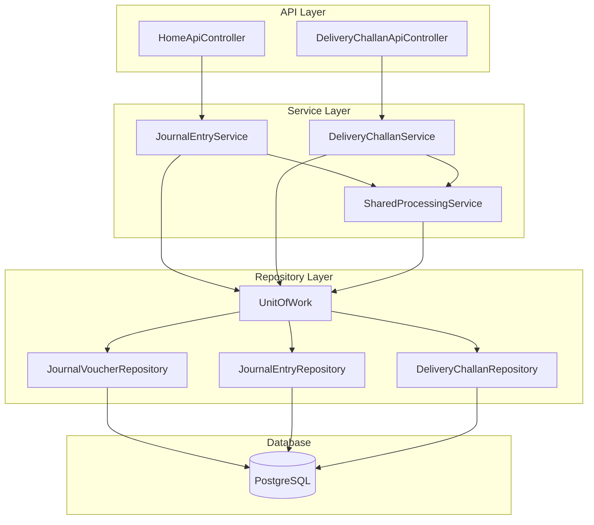

### 9.2 Voucher Lifecycle

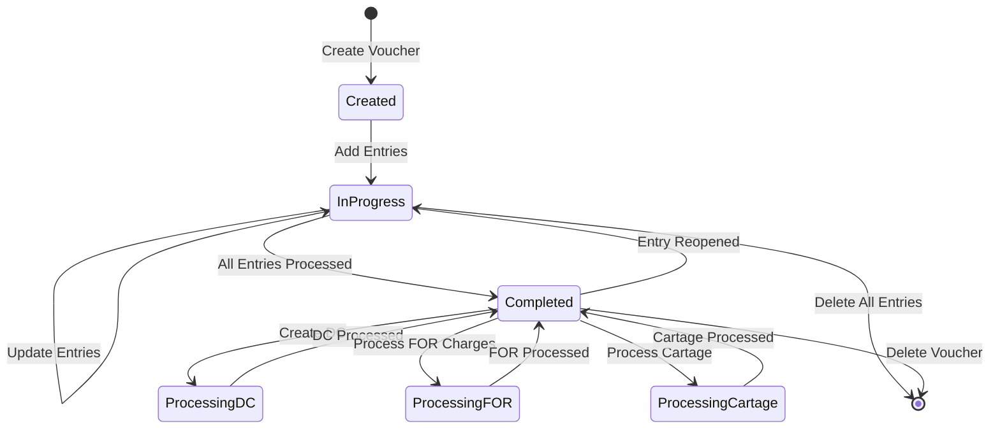

### 9.3 Entry Processing Flow

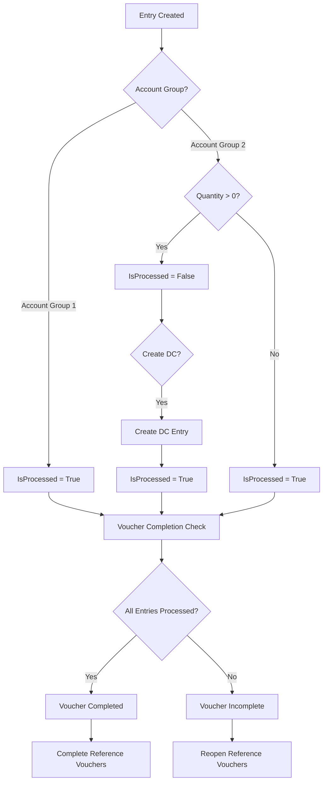

---

## 10. Code Quality Metrics

### 10.1 Complexity Analysis

| Component | Cyclomatic Complexity | Maintainability Index | Lines of Code |
|-----------|----------------------|---------------------|---------------|
| SharedProcessingService | Medium | High | 409 |
| JournalEntryService | High | Medium | 1226 |
| DeliveryChallanService | High | Medium | 1257 |
| HomeApiController | Low | High | 957 |
| DeliveryChallanApiController | Low | High | 472 |

### 10.2 Test Coverage

**Current State:** No unit tests found

**Recommendation:** Add unit tests for:
- Entry processing state determination
- Voucher completion logic
- Reference voucher management
- DC entry creation

---

## 11. Conclusion

The PureLedger codebase demonstrates solid architectural principles with clear separation of concerns and proper transaction management. However, several critical issues need to be addressed, particularly around validation and race condition handling.

**Key Strengths:**
- Well-structured service layer
- Comprehensive business logic coverage
- Good transaction management
- Proper cleanup of related entities

**Key Weaknesses:**
- Missing validation in critical paths
- Potential race conditions
- High complexity in some methods
- Limited error recovery

**Overall Assessment:** The system is production-ready with fixes for critical issues. The architecture is sound and can scale with proper validation and error handling improvements.

---

**Report Generated:** 2024-12-19  
**Next Review:** After critical fixes implemented

