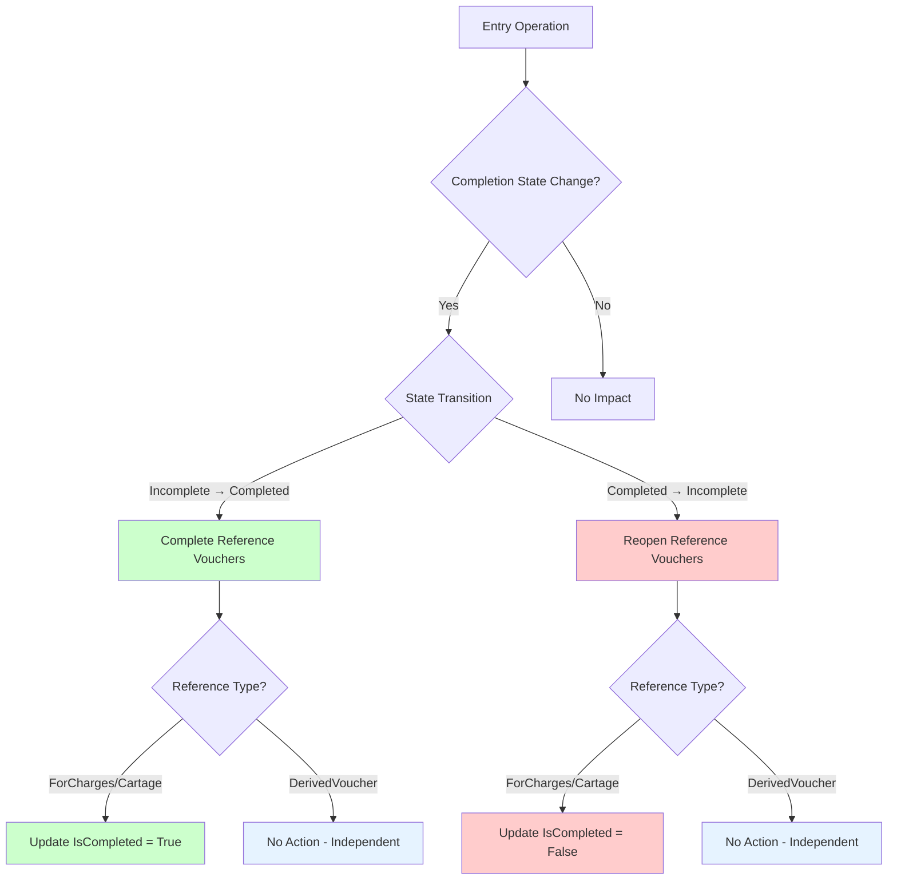
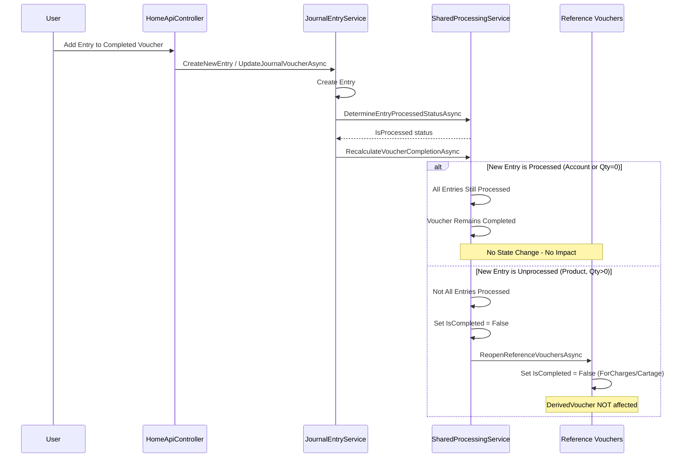
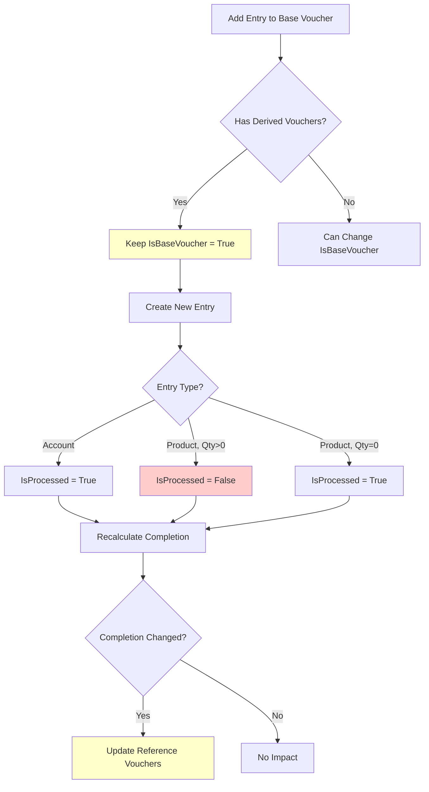
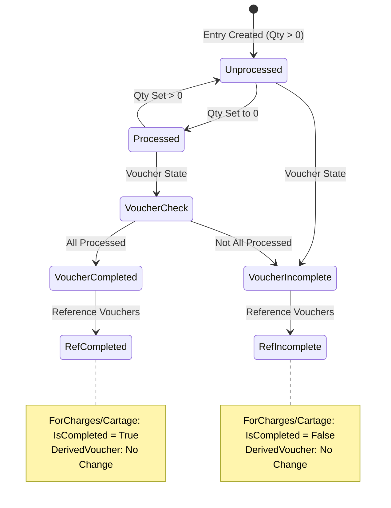
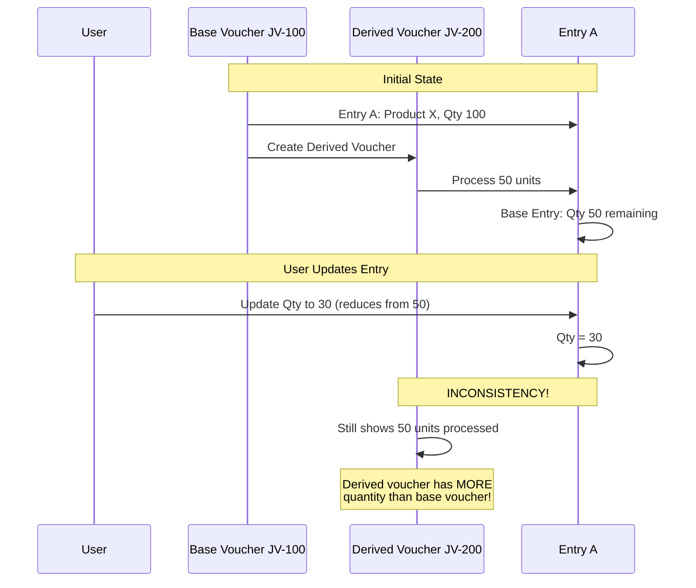
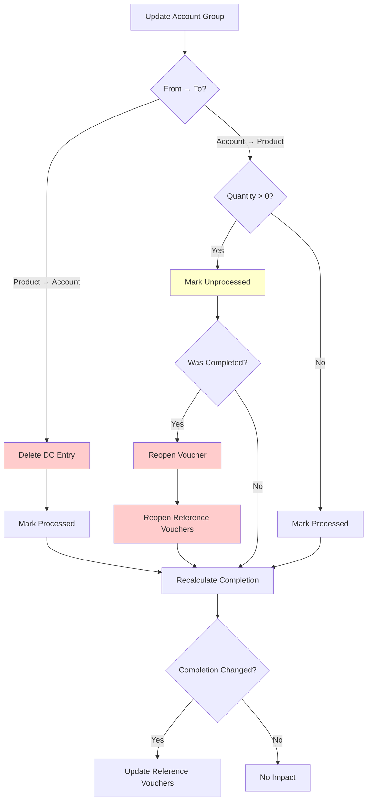
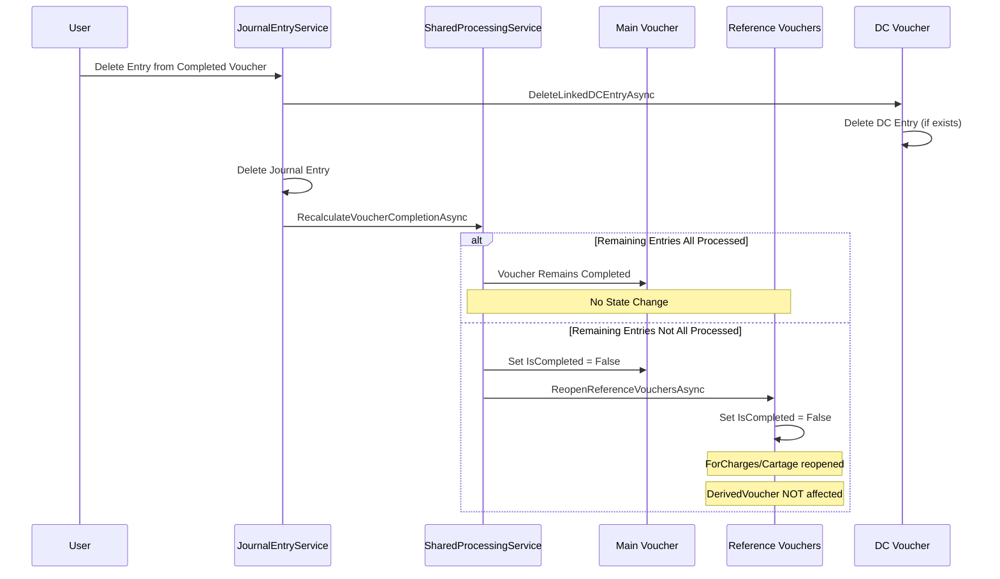
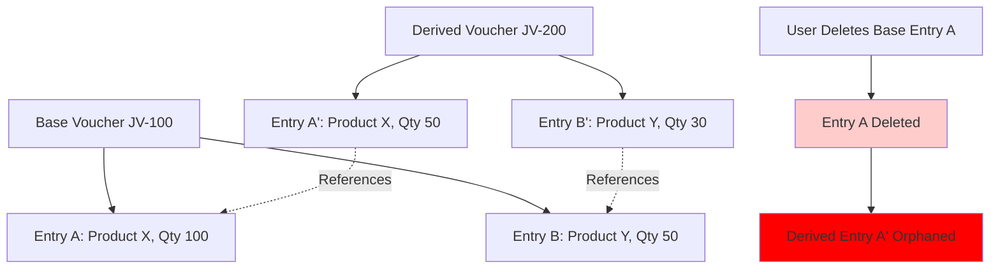
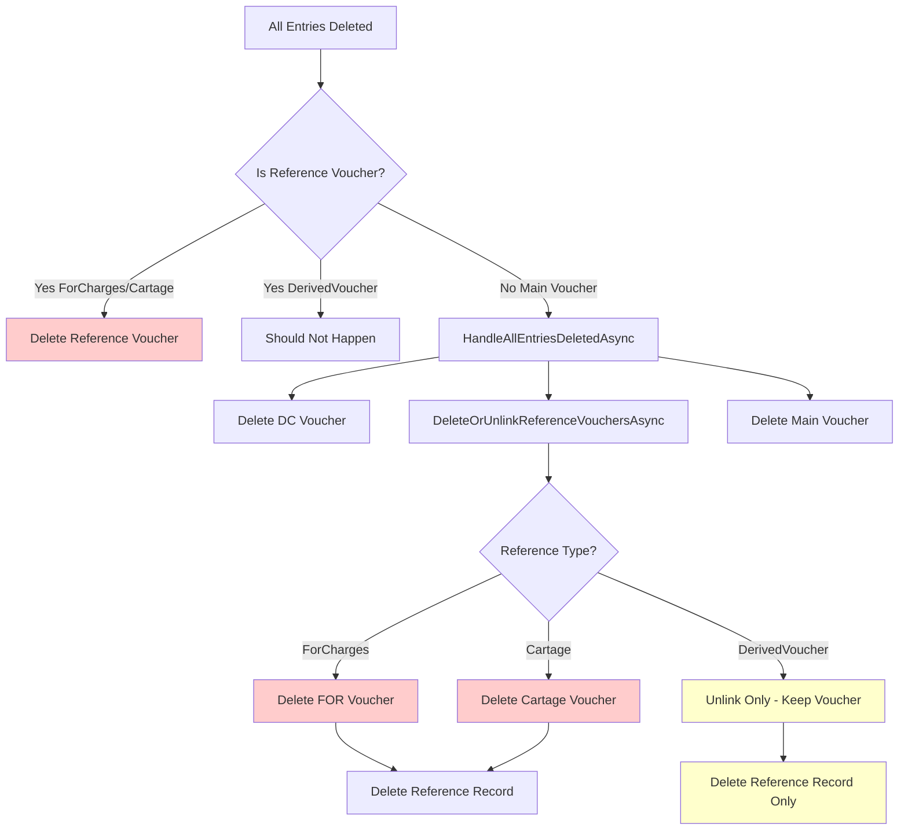

# Reference Voucher Consistency Analysis

**Analysis Date:** December 19, 2024  
**Purpose:** Identify scenarios where adding, updating, or deleting entries could cause referenced journal vouchers to be missed or create data inconsistencies

---

## Executive Summary

This document analyzes **all entry operations** (Add, Update, Delete) and their impact on **referenced journal vouchers** (ForCharges, Cartage, DerivedVoucher). The analysis identifies **critical inconsistencies** and **edge cases** that could lead to data corruption or orphaned references.

**Critical Findings:**
- 🔴 **7 Critical Issues** identified
- 🟡 **12 Important Issues** identified
- 🟢 **5 Minor Issues** identified

---

## Table of Contents

1. [Entry Operation Impact Matrix](#1-entry-operation-impact-matrix)
2. [Adding Entry Scenarios](#2-adding-entry-scenarios)
3. [Updating Entry Scenarios](#3-updating-entry-scenarios)
4. [Deleting Entry Scenarios](#4-deleting-entry-scenarios)
5. [Reference Voucher Types Analysis](#5-reference-voucher-types-analysis)
6. [Critical Inconsistencies](#6-critical-inconsistencies)
7. [Edge Cases & Race Conditions](#7-edge-cases--race-conditions)
8. [Recommendations](#8-recommendations)

---

## 1. Entry Operation Impact Matrix

### Impact on Reference Vouchers

| Operation | ForCharges | Cartage | DerivedVoucher | Risk Level |
|-----------|------------|---------|----------------|------------|
| **Add Entry** | ✅ Safe | ✅ Safe | ⚠️ Medium | Medium |
| **Update Entry (Qty)** | ⚠️ Medium | ⚠️ Medium | 🔴 High | High |
| **Update Entry (Account)** | ⚠️ Medium | ⚠️ Medium | 🔴 High | High |
| **Update Entry (Processed)** | ⚠️ Medium | ⚠️ Medium | ✅ Safe | Medium |
| **Delete Entry** | 🔴 High | 🔴 High | 🔴 High | Critical |

### State Transition Impact



---

## 2. Adding Entry Scenarios

### 2.1 Adding Entry to Completed Voucher

**Scenario:** Add new entry to a voucher that is already completed (all existing entries processed)

**Current Behavior:**
```csharp
// In CreateJournalVoucherAsync / UpdateJournalVoucherAsync
newEntry.IsProcessed = await _sharedProcessingService.DetermineEntryProcessedStatusAsync(newEntry);
// Recalculate completion
await _sharedProcessingService.RecalculateVoucherCompletionAsync(voucherId);
```

**Flow Diagram:**



**Issues Identified:**

1. ✅ **Correct Behavior:** Unprocessed entry correctly reopens voucher and reference vouchers
2. ⚠️ **Issue 2.1:** No validation that user should be allowed to add entry to completed voucher
3. ⚠️ **Issue 2.2:** No check if reference vouchers are in use (e.g., printed, exported)

**Impact on Reference Vouchers:**

| Reference Type | Impact | Consistency Risk |
|----------------|--------|------------------|
| **ForCharges** | Reopened (IsCompleted = False) | ⚠️ Medium - Could cause accounting inconsistency |
| **Cartage** | Reopened (IsCompleted = False) | ⚠️ Medium - Could cause accounting inconsistency |
| **DerivedVoucher** | No Impact | ✅ Safe - Independent |

---

### 2.2 Adding Entry to Base Voucher with Derived Vouchers

**Scenario:** Add entry to a base voucher that already has derived vouchers

**Current Behavior:**
```csharp
// In UpdateJournalVoucherAsync
var hasReferences = await _unitOfWork.JournalVoucherReferences.GetByMainVoucherIdAsync(voucherId);
existingVoucher.IsBaseVoucher = hasReferences.Any() ? wasBaseVoucher : model.IsBaseVoucher;
```

**Flow Diagram:**



**Issues Identified:**

1. ✅ **Correct Behavior:** Base voucher status preserved when derived vouchers exist
2. 🔴 **Issue 2.3 (CRITICAL):** New entry could have quantity that should be available for derived vouchers, but no mechanism to track this
3. ⚠️ **Issue 2.4:** No validation that new entry doesn't duplicate existing derived voucher entries

**Impact on Reference Vouchers:**

| Reference Type | Impact | Consistency Risk |
|----------------|--------|------------------|
| **DerivedVoucher** | No Direct Impact | 🔴 **HIGH** - New entry not reflected in derived vouchers |
| **ForCharges** | Reopened if voucher incomplete | ⚠️ Medium |
| **Cartage** | Reopened if voucher incomplete | ⚠️ Medium |

**Critical Scenario:**
```
Base Voucher (JV-100):
  - Entry A: Product X, Qty 100 (processed in Derived JV-200)
  - Entry B: Product Y, Qty 50 (processed in Derived JV-200)
  
User adds Entry C: Product Z, Qty 75
  
Result:
  - Entry C is available for new derived vouchers
  - But JV-200 doesn't know about Entry C
  - If JV-200 is "complete", it's missing Entry C
  - This is CORRECT behavior, but could be confusing
```

---

## 3. Updating Entry Scenarios

### 3.1 Updating Entry Quantity (Product Entry)

**Scenario:** Update quantity of a product entry that affects processed status

**Current Behavior:**
```csharp
// In HandleProductQuantityChangeAsync
if (oldQuantity > 0 && entry.Quantity <= 0)
{
    // Delete DC entry, mark processed
    await _sharedProcessingService.DeleteLinkedDCEntryAsync(entry.JournalEntryId);
    entry.IsProcessed = true;
    await _sharedProcessingService.RecalculateVoucherCompletionAsync(voucherId);
}
else if (oldQuantity <= 0 && entry.Quantity > 0)
{
    // Mark unprocessed, reopen if needed
    entry.IsProcessed = false;
    if (wasCompleted)
    {
        voucher.IsCompleted = false;
        await _sharedProcessingService.ReopenReferenceVouchersAsync(voucherId);
    }
}
```

**Flow Diagram:**



**Issues Identified:**

1. ✅ **Correct Behavior:** Proper state transitions
2. 🔴 **Issue 3.1 (CRITICAL):** If entry is part of a derived voucher, changing quantity doesn't update derived voucher
3. ⚠️ **Issue 3.2:** No validation that quantity change is valid (e.g., can't set negative)
4. ⚠️ **Issue 3.3:** If entry was processed in derived voucher, changing quantity could create inconsistency

**Critical Scenario - Base Voucher Entry Update:**



**Impact Analysis:**

| Scenario | Base Entry Qty | Derived Processed | Consistency | Risk |
|----------|---------------|-------------------|-------------|------|
| Reduce Qty < Processed | 30 | 50 | ❌ **BROKEN** | 🔴 Critical |
| Reduce Qty = Processed | 50 | 50 | ✅ OK | ✅ Safe |
| Reduce Qty > Processed | 80 | 50 | ✅ OK | ✅ Safe |
| Increase Qty | 100 | 50 | ✅ OK | ✅ Safe |

**🔴 CRITICAL ISSUE:** No validation prevents reducing base entry quantity below what's been processed in derived vouchers!

---

### 3.2 Updating Entry Account Group

**Scenario:** Change entry from Product to Account or vice versa

**Current Behavior:**
```csharp
// In HandleEntryUpdateAsync
if (oldAccountGroupId == ACCOUNT_GROUP_PRODUCT && newAccountGroupId == ACCOUNT_GROUP_ACCOUNT)
{
    // Delete DC entry, mark processed
    await _sharedProcessingService.DeleteLinkedDCEntryAsync(entry.JournalEntryId);
    entry.IsProcessed = true;
}
else if (oldAccountGroupId == ACCOUNT_GROUP_ACCOUNT && newAccountGroupId == ACCOUNT_GROUP_PRODUCT)
{
    // Determine processing state, handle reopening
    entry.IsProcessed = await _sharedProcessingService.DetermineEntryProcessedStatusAsync(entry);
    if (wasCompleted && !entry.IsProcessed)
    {
        voucher.IsCompleted = false;
        await _sharedProcessingService.ReopenReferenceVouchersAsync(voucherId);
    }
}
```

**Flow Diagram:**



**Issues Identified:**

1. ✅ **Correct Behavior:** Proper DC cleanup and state management
2. 🔴 **Issue 3.4 (CRITICAL):** If entry was processed in derived voucher as Product, changing to Account creates inconsistency
3. ⚠️ **Issue 3.5:** No validation that account group change is allowed
4. ⚠️ **Issue 3.6:** Changing Account → Product could create new processable entry that should be in derived voucher

**Critical Scenario:**

```
Base Voucher (JV-100):
  - Entry A: Product X, Qty 100
  
Derived Voucher (JV-200):
  - Entry A': Product X, Qty 50 (from base Entry A)
  
User changes Base Entry A: Product X → Account Y

Result:
  - Base Entry A: Now Account Y, IsProcessed = True
  - Derived Entry A': Still Product X, Qty 50
  - INCONSISTENCY: Derived voucher references non-existent product entry
```

---

### 3.3 Updating Entry That's Referenced in Derived Voucher

**Scenario:** Update an entry in base voucher that has been processed in derived voucher

**Current Behavior:**
- No check if entry is referenced in derived voucher
- Update proceeds without validation
- Derived voucher entries are NOT updated

**Issues Identified:**

1. 🔴 **Issue 3.7 (CRITICAL):** No validation that entry can be updated if it's in derived voucher
2. 🔴 **Issue 3.8 (CRITICAL):** Updating base entry doesn't update derived voucher entries
3. ⚠️ **Issue 3.9:** No mechanism to track which entries are "locked" by derived vouchers

**Impact Matrix:**

| Update Type | Base Entry | Derived Entry | Consistency | Risk |
|-------------|------------|--------------|-------------|------|
| Change Description | ✅ Updated | ❌ Not Updated | ⚠️ Minor | 🟡 Low |
| Change Rate | ✅ Updated | ❌ Not Updated | ⚠️ Minor | 🟡 Low |
| Change Quantity (Reduce) | ✅ Updated | ❌ Not Updated | 🔴 **BROKEN** | 🔴 Critical |
| Change Account | ✅ Updated | ❌ Not Updated | 🔴 **BROKEN** | 🔴 Critical |
| Change Category | ✅ Updated | ❌ Not Updated | ⚠️ Minor | 🟡 Low |

---

## 4. Deleting Entry Scenarios

### 4.1 Deleting Entry from Completed Voucher

**Scenario:** Delete an entry from a completed voucher

**Current Behavior:**
```csharp
// In DeleteJournalEntryInternalAsync
await _sharedProcessingService.DeleteLinkedDCEntryAsync(entryId);
await _unitOfWork.JournalEntries.DeleteAsync(entryId);
await _sharedProcessingService.RecalculateVoucherCompletionAsync(voucherId);
```

**Flow Diagram:**



**Issues Identified:**

1. ✅ **Correct Behavior:** Proper state management
2. ⚠️ **Issue 4.1:** No check if entry is referenced in derived voucher
3. ⚠️ **Issue 4.2:** Deleting entry could break derived voucher integrity

---

### 4.2 Deleting Entry from Base Voucher with Derived Vouchers

**Scenario:** Delete entry from base voucher that has been processed in derived voucher

**Current Behavior:**
- Entry is deleted without checking derived vouchers
- Derived voucher entries remain but reference deleted base entry

**Critical Scenario:**



**Issues Identified:**

1. 🔴 **Issue 4.3 (CRITICAL):** Deleting base entry doesn't check if it's in derived voucher
2. 🔴 **Issue 4.4 (CRITICAL):** Derived voucher entries become orphaned
3. 🔴 **Issue 4.5 (CRITICAL):** No validation prevents deletion of referenced entries

**Impact:**

| Scenario | Base Entry | Derived Entry | Consistency | Risk |
|----------|------------|--------------|-------------|------|
| Delete Processed Entry | ❌ Deleted | ✅ Still Exists | 🔴 **BROKEN** | 🔴 Critical |
| Delete Unprocessed Entry | ❌ Deleted | N/A | ✅ OK | ✅ Safe |

---

### 4.3 Deleting All Entries from Voucher

**Scenario:** Delete all entries from a voucher (empty voucher)

**Current Behavior:**
```csharp
// In RecalculateVoucherCompletionAsync
if (!entries.Any())
{
    bool wasReferenceVoucher = await DeleteReferenceVoucherIfEmptyAsync(journalVoucherId);
    if (wasReferenceVoucher) return true;
    
    await HandleAllEntriesDeletedAsync(journalVoucherId);
    await _unitOfWork.JournalVouchers.DeleteAsync(journalVoucherId);
}
```

**Flow Diagram:**



**Issues Identified:**

1. ✅ **Correct Behavior:** Proper cleanup of reference vouchers
2. ⚠️ **Issue 4.6:** No check if derived vouchers should be preserved when base voucher is deleted
3. ⚠️ **Issue 4.7:** Deleting base voucher with derived vouchers could leave derived vouchers without reference

**Critical Scenario - Base Voucher Deletion:**

```
Base Voucher (JV-100):
  - Entry A: Product X, Qty 100
  - Entry B: Product Y, Qty 50
  
Derived Voucher (JV-200):
  - Entry A': Product X, Qty 50 (from Entry A)
  - Entry B': Product Y, Qty 30 (from Entry B)
  
User deletes all entries from Base Voucher:
  - Base Voucher JV-100 is deleted
  - Reference to JV-200 is unlinked
  - Derived Voucher JV-200 remains but has no base reference
  
Result:
  - Derived voucher is orphaned
  - No way to trace back to original base voucher
  - This is INTENTIONAL (per design), but could be confusing
```

---

## 5. Reference Voucher Types Analysis

### 5.1 ForCharges Reference Vouchers

**Characteristics:**
- Created when processing FOR charges
- Contains account entries only (always processed)
- Automatically completed when created
- Deleted when main voucher is deleted
- Reopened when main voucher is reopened

**Consistency Risks:**

| Operation | Risk | Impact |
|-----------|------|--------|
| Add Entry | 🟡 Low | Could reopen voucher if entry unprocessed |
| Update Entry | 🟡 Medium | Could reopen voucher if completion changes |
| Delete Entry | 🔴 High | Could reopen voucher, but FOR voucher remains completed |

**Critical Issue:**
- ⚠️ **Issue 5.1:** FOR voucher is always completed (account entries), but main voucher reopening doesn't affect FOR voucher entries

---

### 5.2 Cartage Reference Vouchers

**Characteristics:**
- Created during cartage processing
- Contains account entries only (always processed)
- Automatically completed when created
- Deleted when main voucher is deleted
- Reopened when main voucher is reopened

**Consistency Risks:**

| Operation | Risk | Impact |
|-----------|------|--------|
| Add Entry | 🟡 Low | Could reopen voucher if entry unprocessed |
| Update Entry | 🟡 Medium | Could reopen voucher if completion changes |
| Delete Entry | 🔴 High | Could reopen voucher, but cartage voucher remains completed |

**Critical Issue:**
- ⚠️ **Issue 5.2:** Same as ForCharges - cartage voucher entries are always processed, but main voucher state affects cartage voucher completion status

---

### 5.3 DerivedVoucher Reference Vouchers

**Characteristics:**
- Created from base vouchers
- Contains product entries from base voucher
- Independent completion status
- NOT deleted when base voucher is deleted
- NOT affected by base voucher completion state changes

**Consistency Risks:**

| Operation | Risk | Impact |
|-----------|------|--------|
| Add Entry | 🔴 **CRITICAL** | New entry not in derived vouchers |
| Update Entry | 🔴 **CRITICAL** | Base entry change doesn't update derived entries |
| Delete Entry | 🔴 **CRITICAL** | Base entry deletion orphans derived entries |

**Critical Issues:**

1. 🔴 **Issue 5.3 (CRITICAL):** Base entry updates don't propagate to derived vouchers
2. 🔴 **Issue 5.4 (CRITICAL):** Base entry deletion doesn't validate derived voucher references
3. 🔴 **Issue 5.5 (CRITICAL):** No mechanism to track which entries are "locked" by derived vouchers

---

## 6. Critical Inconsistencies

### 6.1 Base Entry Update Doesn't Update Derived Voucher

**Scenario:** Update base entry that's been processed in derived voucher

**Problem:**
```csharp
// In UpdateJournalEntryAsync
// No check if entry is in derived voucher
// No update of derived voucher entries
UpdateEntryFromViewModel(entry, model);
// Derived voucher entries remain unchanged
```

**Impact:**
- Derived voucher entries become inconsistent with base entry
- Quantity mismatches possible
- Account/category changes not reflected

**Fix Required:**
```csharp
// Before updating base entry
var derivedVouchers = await GetDerivedVouchersForEntryAsync(entryId);
if (derivedVouchers.Any())
{
    throw new InvalidOperationException(
        "Cannot update entry that has been processed in derived vouchers");
}
```

---

### 6.2 Base Entry Deletion Doesn't Check Derived Vouchers

**Scenario:** Delete base entry that's been processed in derived voucher

**Problem:**
```csharp
// In DeleteJournalEntryInternalAsync
// No check if entry is in derived voucher
await _unitOfWork.JournalEntries.DeleteAsync(entryId);
// Derived voucher entries become orphaned
```

**Impact:**
- Derived voucher entries reference non-existent base entry
- Data integrity violation
- Potential foreign key issues

**Fix Required:**
```csharp
// Before deleting entry
var derivedVouchers = await GetDerivedVouchersForEntryAsync(entryId);
if (derivedVouchers.Any())
{
    throw new InvalidOperationException(
        "Cannot delete entry that has been processed in derived vouchers");
}
```

---

### 6.3 Quantity Reduction Below Processed Amount

**Scenario:** Reduce base entry quantity below what's been processed in derived vouchers

**Problem:**
```csharp
// In HandleProductQuantityChangeAsync
// No validation that new quantity >= processed amount
entry.Quantity = model.Quantity;
// Could set quantity to 30 when 50 already processed
```

**Impact:**
- Base entry quantity becomes less than processed amount
- Derived vouchers show more quantity than available
- Accounting inconsistency

**Fix Required:**
```csharp
// Before updating quantity
var processedQty = await GetProcessedQuantityInDerivedVouchersAsync(entryId);
if (model.Quantity < processedQty)
{
    throw new InvalidOperationException(
        $"Cannot reduce quantity below processed amount: {processedQty}");
}
```

---

### 6.4 Account Group Change on Processed Entry

**Scenario:** Change entry account group when entry is in derived voucher

**Problem:**
```csharp
// In HandleEntryUpdateAsync
// No check if entry is in derived voucher
if (oldAccountGroupId == ACCOUNT_GROUP_PRODUCT && 
    newAccountGroupId == ACCOUNT_GROUP_ACCOUNT)
{
    // Changes entry type
    // Derived voucher still has product entry
}
```

**Impact:**
- Base entry becomes account type
- Derived voucher still has product entry
- Type mismatch

**Fix Required:**
```csharp
// Before changing account group
var derivedVouchers = await GetDerivedVouchersForEntryAsync(entryId);
if (derivedVouchers.Any())
{
    throw new InvalidOperationException(
        "Cannot change account group of entry in derived vouchers");
}
```

---

## 7. Edge Cases & Race Conditions

### 7.1 Concurrent Entry Updates

**Scenario:** Multiple users update entries simultaneously

**Problem:**
```csharp
// No optimistic concurrency for entries
// Only vouchers have RowVersion
entry.Quantity = model.Quantity;
// Two users could update simultaneously
```

**Impact:**
- Last write wins
- Lost updates possible
- Inconsistent state

**Fix Required:**
```csharp
// Add RowVersion to JournalEntry
[Timestamp]
public byte[]? RowVersion { get; set; }

// Check in update
if (entry.RowVersion != model.RowVersion)
{
    throw new DbUpdateConcurrencyException("Entry was modified");
}
```

---

### 7.2 Voucher Completion Race Condition

**Scenario:** Multiple entries updated simultaneously affecting completion

**Problem:**
```csharp
// In RecalculateVoucherCompletionAsync
var entries = voucher.JournalEntries?.ToList() ?? new List<JournalEntry>();
var newState = entries.All(e => e.IsProcessed);
// Entries could change during this check
```

**Impact:**
- Completion status calculated on stale data
- Incorrect reference voucher state

**Fix Required:**
```csharp
// Use database-level check
var newState = await _context.JournalEntries
    .Where(e => e.JournalVoucherId == journalVoucherId)
    .AllAsync(e => e.IsProcessed);
```

---

### 7.3 Derived Voucher Creation During Base Update

**Scenario:** Create derived voucher while base voucher is being updated

**Problem:**
```csharp
// User A: Updating base voucher entries
// User B: Creating derived voucher from same base
// Both operations read base entries
// Derived voucher could have stale data
```

**Impact:**
- Derived voucher created with old entry data
- Inconsistency between base and derived

**Fix Required:**
```csharp
// Use transaction isolation level
using var transaction = await _unitOfWork.BeginTransactionAsync(
    IsolationLevel.Serializable);
```

---

## 8. Recommendations

### 8.1 Critical Fixes (Priority 1)

1. **Add Entry Reference Validation**
   ```csharp
   public async Task<bool> IsEntryReferencedInDerivedVouchersAsync(int entryId)
   {
       // Check if entry quantity has been processed in derived vouchers
       var processedQty = await GetProcessedQuantityInDerivedVouchersAsync(entryId);
       return processedQty > 0;
   }
   ```

2. **Prevent Base Entry Updates When Referenced**
   ```csharp
   // In UpdateJournalEntryAsync
   if (await IsEntryReferencedInDerivedVouchersAsync(entryId))
   {
       throw new InvalidOperationException(
           "Cannot update entry that has been processed in derived vouchers");
   }
   ```

3. **Prevent Base Entry Deletion When Referenced**
   ```csharp
   // In DeleteJournalEntryInternalAsync
   if (await IsEntryReferencedInDerivedVouchersAsync(entryId))
   {
       throw new InvalidOperationException(
           "Cannot delete entry that has been processed in derived vouchers");
   }
   ```

4. **Validate Quantity Changes**
   ```csharp
   // In HandleProductQuantityChangeAsync
   var processedQty = await GetProcessedQuantityInDerivedVouchersAsync(entryId);
   if (model.Quantity < processedQty)
   {
       throw new InvalidOperationException(
           $"Cannot reduce quantity below processed amount: {processedQty}");
   }
   ```

### 8.2 Important Fixes (Priority 2)

1. **Add Optimistic Concurrency for Entries**
2. **Add Database-Level Completion Check**
3. **Implement Entry Locking Mechanism**
4. **Add Audit Trail for Entry Changes**

### 8.3 Nice to Have (Priority 3)

1. **Add Entry Version History**
2. **Implement Entry Change Notifications**
3. **Add Derived Voucher Sync Mechanism**
4. **Create Entry Dependency Graph**

---

## 9. Summary of Critical Issues

### 🔴 Must Fix Before Production

| Issue ID | Description | Severity | Impact |
|----------|-------------|----------|--------|
| 3.1 | Base entry update doesn't update derived voucher | Critical | Data inconsistency |
| 3.4 | Account group change on processed entry | Critical | Type mismatch |
| 4.3 | Base entry deletion doesn't check derived vouchers | Critical | Orphaned references |
| 4.4 | Derived voucher entries become orphaned | Critical | Data integrity |
| 5.3 | Base entry updates don't propagate | Critical | Inconsistency |
| 5.4 | No validation for locked entries | Critical | Data corruption |
| 6.3 | Quantity reduction below processed amount | Critical | Accounting error |

### 🟡 Should Fix Soon

| Issue ID | Description | Severity | Impact |
|----------|-------------|----------|--------|
| 2.3 | New entry not reflected in derived vouchers | Medium | Confusion |
| 3.2 | No quantity validation | Medium | Invalid data |
| 4.1 | No check if entry is referenced | Medium | Potential issues |
| 7.1 | Concurrent update race condition | Medium | Lost updates |
| 7.2 | Completion calculation race condition | Medium | Incorrect state |

---

## 10. Conclusion

The current implementation has **significant gaps** in handling entry operations when referenced vouchers exist. The most critical issues are:

1. **Base entry updates/deletes don't validate derived voucher references**
2. **No mechanism to prevent inconsistent state**
3. **Race conditions in concurrent operations**

**Recommendation:** Implement the critical fixes before production deployment to ensure data integrity and consistency.

---

**Document Version:** 1.0  
**Last Updated:** December 19, 2024  
**Next Review:** After critical fixes implementation


